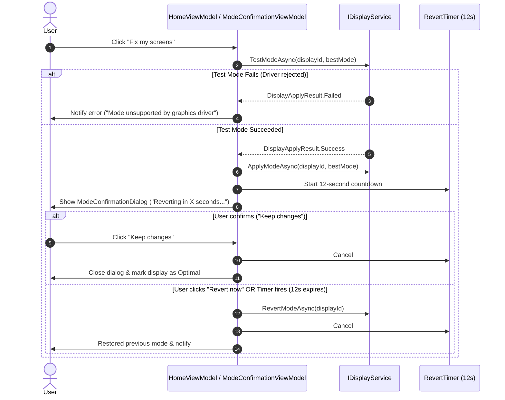

# Zien Display Fixer - System Architecture & Design Specification

**Date:** 2026-11-23  
**Status:** Draft for Review  
**Target Platform:** .NET 10, Avalonia 12, CommunityToolkit.Mvvm (Windows, macOS, Linux)  

---

## 1. Executive Summary & Intent

**Zien Display Fixer** is a cross-platform desktop application designed to solve common multi-monitor setup issues (mismatched resolutions, sub-optimal refresh rates, distorted aspect ratios, and blurry scaling). 

When external displays are connected, users can either have optimal settings applied automatically or click a single button ("**Fix my screens**") to configure each screen to its native resolution, ideal aspect ratio, and highest supported stable refresh rate. The app reads each monitor's Extended Display Identification Data (EDID) directly to determine its physical size, native mode, and hardware model.

To prevent display lockouts or black screens, every display mode change is tested first, applied, and monitored via a **12-second countdown confirmation dialog**; if the user does not confirm within 12 seconds, settings automatically revert to the previous safe configuration.

The visual style is **minimal, premium, and calm**: a graphite dark background, champagne accent, subtle borders, Inter typography, and dynamic dark/light theme support adhering to OS preferences.

---

## 2. Goals, Non-Goals & Anti-Goals

### 2.1 Goals
- **Single-Click Screen Optimization:** Automatically detect and set each display's best native resolution, aspect ratio, and refresh rate.
- **Hardware-Accurate EDID Parsing:** Extract vendor name, model description, physical screen dimensions (diagonal inches), preferred timing descriptors (native mode), and CEA extensions without third-party native binaries.
- **Strict OS Isolation:** Keep all OS-specific APIs (Win32/WMI/CCD, macOS CoreGraphics/IORegistry, Linux DRM/XRandR) behind clean interfaces selected at startup via `RuntimeInformation.IsOSPlatform`.
- **Pure C# Core with 100% Testable Domain Logic:** All EDID parsing, mode selection heuristics, and desk scene layout geometry are in a standalone library with comprehensive xUnit tests.
- **Fail-Safe Confirmation Flow:** 12-second countdown confirmation with automated rollback upon timeout or cancellation.
- **Interactive Visual Desk Scene:** Render an intuitive visual arrangement of the user's workstation (Laptop or PC tower) connected to monitors via realistic cables (wired with pulse animation or wireless with Wi-Fi indicators).
- **Lightweight & Modular Codebase:** Small, focused files adhering to Single Responsibility Principle.

### 2.2 Non-Goals
- Hardware colorimeter display calibration (ICC profile creation via hardware pucks like Spyder/i1Display).
- Graphics driver overclocking or custom resolution utility (CRU) timing hacks beyond what the graphics driver reports as supported.
- Video wall edge-blending or multi-GPU SLI/Crossfire virtualization.

### 2.3 Anti-Goals
- No aggressive, loud, or sci-fi visual gimmicks (no neon glows, noisy particle systems, or intrusive animations).
- No unverified direct mode switches that could leave a user with a blank monitor and no way to recover.
- No OS-specific code leaking into ViewModels, Views, or Core business logic.

---

## 3. Architecture & Project Structure

The solution adopts a clean multi-project structure:

```text
Zien Display Fixer/
├── docs/
│   └── superpowers/specs/2026-11-23-zien-display-fixer-design.md
├── src/
│   ├── ZienDisplayFixer.Core/             # Pure C# Class Library (.NET 10)
│   │   ├── Models/                        # Display, Mode, Edid, Scene, Topology models
│   │   ├── Edid/                          # Binary EDID parser & CEA-861 decoder
│   │   ├── Engine/                        # BestModeSelector & Heuristics
│   │   ├── Layout/                        # SceneLayoutEngine & Geometry calculations
│   │   └── Interfaces/                    # OS service contracts
│   ├── ZienDisplayFixer.App/              # Avalonia 12 Desktop Application (.NET 10)
│   │   ├── Assets/                        # Fonts, Icons, Themes
│   │   ├── Controls/                      # DeskSceneControl (custom canvas/geometry)
│   │   ├── Converters/                    # Value converters
│   │   ├── Services/                      # Platform service implementations
│   │   │   ├── PlatformServiceFactory.cs  # OS selection via RuntimeInformation
│   │   │   ├── Windows/                   # Win32 CCD / EnumDisplaySettings / WMI
│   │   │   ├── Mac/                       # macOS CoreGraphics / IORegistry stubs
│   │   │   └── Linux/                     # Linux DRM / sysfs / XRandR stubs
│   │   ├── ViewModels/                    # CommunityToolkit.Mvvm ViewModels
│   │   │   ├── MainViewModel.cs
│   │   │   ├── HomeViewModel.cs
│   │   │   ├── DisplaysViewModel.cs
│   │   │   ├── WirelessViewModel.cs
│   │   │   ├── SettingsViewModel.cs
│   │   │   └── ModeConfirmationViewModel.cs
│   │   ├── Views/                         # Avalonia AXAML Views
│   │   │   ├── MainWindow.axaml
│   │   │   ├── HomeView.axaml
│   │   │   ├── DisplaysView.axaml
│   │   │   ├── WirelessView.axaml
│   │   │   ├── SettingsView.axaml
│   │   │   └── ModeConfirmationDialog.axaml
│   │   ├── App.axaml
│   │   └── Program.cs
│   └── ZienDisplayFixer.Tests/            # xUnit Test Project (.NET 10)
│       ├── Edid/                          # Test fixtures with real-world binary EDIDs
│       ├── Engine/                        # BestModeSelector unit tests
│       └── Layout/                        # SceneLayoutEngine math & boundary tests
└── ZienDisplayFixer.sln
```

---

## 4. Subsystem Details & Technical Specifications

### 4.1 Interface Contracts (`ZienDisplayFixer.Core/Interfaces`)

All operating system specific operations are isolated behind the following contracts:

1. **`IDisplayService`**
   ```csharp
   public interface IDisplayService
   {
       Task<IReadOnlyList<DisplayInfo>> GetConnectedDisplaysAsync(CancellationToken ct = default);
       Task<IReadOnlyList<DisplayMode>> GetSupportedModesAsync(string displayId, CancellationToken ct = default);
       Task<DisplayApplyResult> TestModeBatchAsync(IReadOnlyDictionary<string, DisplayMode> targetModes, CancellationToken ct = default);
       Task<DisplayApplyResult> ApplyModeBatchAsync(IReadOnlyDictionary<string, DisplayMode> targetModes, CancellationToken ct = default);
       Task RevertLastBatchAsync(CancellationToken ct = default);
       event EventHandler DisplayConfigurationChanged;
   }
   ```
   *(Builder Decision: Batch operations are adopted to adjust multiple displays atomically in a single OS transaction, preventing multiple display flicker cycles and unifying the 12-second confirmation into a single prompt).*

2. **`IEdidReader`**
   ```csharp
   public interface IEdidReader
   {
       Task<byte[]?> ReadRawEdidAsync(string displayId, CancellationToken ct = default);
       Task<IReadOnlyDictionary<string, byte[]>> ReadAllEdidsAsync(CancellationToken ct = default);
   }
   ```

3. **`IScreenModeService`**
   ```csharp
   public interface IScreenModeService
   {
       Task<ScreenTopology> GetCurrentTopologyAsync(CancellationToken ct = default);
       Task SetTopologyAsync(ScreenTopology topology, CancellationToken ct = default);
   }
   ```

4. **`IWallpaperService`**
   ```csharp
   public interface IWallpaperService
   {
       Task<string?> GetCurrentWallpaperPathAsync(CancellationToken ct = default);
       Task<Stream?> GetWallpaperImageStreamAsync(CancellationToken ct = default);
       event EventHandler WallpaperChanged;
   }
   ```

5. **`IWirelessDisplayLauncher`**
   ```csharp
   public interface IWirelessDisplayLauncher
   {
       bool IsSupported { get; }
       Task OpenWirelessDisplayPickerAsync(CancellationToken ct = default);
       Task<IReadOnlyList<WirelessDisplayDevice>> ScanNearbyAsync(CancellationToken ct = default);
   }
   ```
   *(Builder Decision: On Windows, invokes `ms-settings-connectabledevices:` / WinRT casting flyout for seamless pairing, while `ScanNearbyAsync` surfaces nearby Miracast devices in the UI).*

6. **`IAutostartService`**
   ```csharp
   public interface IAutostartService
   {
       bool IsAutostartEnabled();
       void SetAutostart(bool enable);
   }
   ```

---

### 4.1.1 Cross-Platform Scope & OS Support Strategy
- **Windows (Primary / Full Implementation):** Fully implements `WindowsDisplayService` via Win32 CCD (`QueryDisplayConfig`, `SetDisplayConfig`), Win32 `EnumDisplaySettingsEx`, WMI `WmiMonitorDescriptorMethods` for EDID, registry-based autostart, and `ms-settings-connectabledevices:` for wireless casting.
- **macOS & Linux (Architectural Stubs / Mocks):** Cleanly implemented with mock providers returning simulated hardware and logging operations. This guarantees the application compiles and launches seamlessly across all platforms without native binding crashes.

---

### 4.1.2 Auto-Optimization vs. Fail-Safe Confirmation
- **Manual "Fix my screens":** Directly enters the 12-second fail-safe confirmation flow with countdown modal.
- **Automatic Optimization on Connect:** When a new display is plugged in and auto-fix is enabled in Settings, the app applies the optimal batch and displays a top-level notification bar with a 12-second countdown ("Optimal settings applied. Revert (12s)?") so users can click Revert if their display experiences issues.

---

### 4.2 EDID Parser (`EdidParser.cs`)

Parses standard VESA EDID 1.3 / 1.4 binary data (128-byte base block + 128-byte extension blocks):
- **Magic Header:** Validates `00 FF FF FF FF FF FF 00`.
- **Checksum:** Validates 8-bit sum modulo 256 equals 0.
- **Vendor & Product Code:** Decodes 3-character compressed ASCII PNP ID (e.g. `DEL` for Dell, `SAM` for Samsung, `LGX` for LG) and 16-bit product code.
- **Physical Size:** Extracts horizontal and vertical screen dimensions in centimeters; calculates diagonal inches:
  $$\text{Diagonal (inches)} = \frac{\sqrt{\text{Width}_{\text{cm}}^2 + \text{Height}_{\text{cm}}^2}}{2.54}$$
- **Preferred Timing Descriptor (PTD):** Parses first 18-byte Detailed Timing Descriptor (bytes 54–71) to extract native active horizontal pixels, active vertical pixels, and exact refresh rate calculated from pixel clock and total blanking intervals.
- **Monitor Descriptor Blocks:** Scans remaining 18-byte descriptor blocks for Display Name (Tag `0xFC`) and Serial Number (Tag `0xFF`).
- **CEA-861 Extension:** When present (Tag `0x02`), parses additional VIC (Video Identification Code) timings for 4K / ultrawide / high refresh display modes.

---

### 4.3 Best-Mode Selection Heuristics (`BestModeSelector.cs`)

Determines the optimal display mode using a deterministic scoring model:

1. **Native Match Bonus (Primary):** Highest priority given to modes matching the EDID Preferred Timing Descriptor resolution.
2. **Aspect Ratio Preservation:** Candidate modes must preserve the display's physical aspect ratio (16:9, 16:10, 21:9, 32:9) unless no native match exists.
3. **Refresh Rate Maximization:** Given matching resolutions, picks the highest refresh rate certified by the monitor's EDID timing ranges and supported by the GPU adapter (e.g., preferring 144Hz over 60Hz on high-refresh panels).
4. **Connection Type Limits:**
   - **VGA / Analog:** Capped to max recommended 1920×1080 @ 60Hz to prevent analog jitter or signal degradation.
   - **Wi-Fi / Miracast:** Capped to 1920×1080 @ 60Hz with low latency profiles.
   - **HDMI / DisplayPort / USB-C / USB-4:** Full bandwidth capabilities utilized.
5. **Fallback Table:** If EDID is unavailable or returns generic uncalibrated modes, provides standard profile mappings based on detected diagonal size and aspect ratio (matching prototype specifications).

---

### 4.4 12-Second Fail-Safe Mode Application Flow



---

### 4.5 Scene Layout Engine (`SceneLayoutEngine.cs`)

Transforms display metadata into scalable coordinate geometry for the interactive desk visualization:
- **Viewport Canvas:** Coordinate space $1000 \times 560$.
- **Host Device:** Centered at $(500, 265)$. 
  - Laptop: Screen width proportional to selected size (13"–17"), keyboard deck with notch, power indicator.
  - PC: Tower case with front vents, ZIEN debossed logo, power button.
- **Display Distribution:** External monitors split into Left (negative $X$) and Right (positive $X$) groups, arranged in columns of up to 3 monitors vertically.
- **Cables & Connections:**
  - Wired: Smooth cubic Bézier spline from PC/laptop output port to monitor stand base, rendered with outer sheath (`var(--cabl)`), core conduit (`var(--cab)`), and an animated accent pulse traveling along the wire.
  - Wireless (Wi-Fi): Dashed glowing line with animated stroke dash-offset, centered pill badge with radio waveform icon.
  - Port Badges: Labeled pills on wired connections (HDMI, DP, USB-C, USB-4, VGA).
- **Monitor Renders:** Bezel frame, inner wallpaper surface with clip-path, display index number, upper model & size tags, status dot (green for optimal, amber for suboptimal), and bottom current resolution/refresh rate string.

---

### 4.6 Design & Visual Aesthetics

- **Color Palette (Dark Theme Default):**
  - Background Base: `#0B0B0D` with radial gradient highlight `#18181C`
  - Card & Panels: `#121215` with fine border `#27272D`
  - Champagne Accent: `#CDB78F` (subtle, non-neon, premium)
  - Typography Color: Primary text `#F1EFEA`, Muted text `#9A978F`
  - Status Indicators: Optimal `#86B894`, Warning/Suboptimal `#D4A35F`
- **Color Palette (Light Theme Variant):**
  - Background Base: `#F4F2ED` with radial highlight `#FCFBF8`
  - Card & Panels: `#FFFFFF` with fine border `#E1DDD3`
  - Champagne Accent: `#8A6A3B`
  - Typography Color: Primary text `#1B1A17`, Muted text `#6B665B`
- **Typography:** Inter (Variable or 300, 400, 500, 600 weights).
- **Interactions:** Subtle hover opacities, 44px minimum touch targets, smooth scale feedback on buttons, respect for `prefers-reduced-motion` to disable pulse animations.

---

## 5. Implementation Phases & Deliverables

1. **Phase 1: Project Scaffolding & Pure C# Core**
   - Solution setup: `ZienDisplayFixer.Core`, `ZienDisplayFixer.App`, `ZienDisplayFixer.Tests`.
   - Implement `EdidParser`, `BestModeSelector`, `SceneLayoutEngine`, domain models, and service interfaces.
   - Comprehensive xUnit tests covering real-world EDID fixtures, mode scoring, and layout math.
2. **Phase 2: Platform Abstraction & Windows Implementation**
   - Implement `WindowsDisplayService` (using Win32 CCD `QueryDisplayConfig` / `SetDisplayConfig` and `EnumDisplaySettingsEx`), `WindowsEdidReader` (via WMI `WmiMonitorDescriptorMethods` / Registry), `WindowsWallpaperService`, `WindowsAutostartService`, and `WindowsWirelessDisplayLauncher`.
   - Implement cross-platform stubs/mocks for macOS & Linux.
3. **Phase 3: Avalonia UI, Themes & Custom Desk Scene View**
   - Implement premium Graphite/Champagne Fluent theme dictionaries for Dark and Light modes.
   - Create custom `DeskSceneControl` rendering host device, monitors, animated cables, and pills.
   - Implement Navigation, Views (`HomeView`, `DisplaysView`, `WirelessView`, `SettingsView`), and ViewModels using `CommunityToolkit.Mvvm`.
4. **Phase 4: 12-Second Safe Mode Application & System Integration**
   - Wire up `ModeConfirmationViewModel` and modal dialog with live 12-second countdown timer.
   - Wire display change events and automatic background optimization triggers.
   - End-to-end testing and verification.

